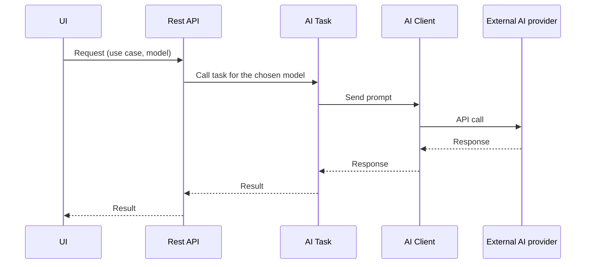

# Jev demo

The purpose of this repo is to check if the things that I heard about jev (that it's significantly faster and cheaper than tradiitonnal LLMs for tasks that do not require a human readable output) are true.

## Infos I found at the time I wrote this

| Model | Input (per 1M tokens) | Output (per 1M tokens) |
|---|---|---|
| Jev | **$0.042** | **Free** |
| GPT 5.5 | **$5.00** -> 119 * Jev | **$30.00** |

## Demos

### Demo use cases

We'll be comparing jev to traditional LLMs for multiple use cases:

- Checking that a given message respects given rules
- Classification of comments on a product (by category -> choice, by satisfaction level -> Score, by urgency -> Noul)
- The same classification, but with all the comments in a single request for each model

### Demo process

For each demo, we will use Jev for a task, and then use GPT 5.5 for the task.

The demo UI will display the result, and the cost (calculated using token usage and the price described in the table above).

## Running the app

Requirements: Rust 1.85 or later (edition 2024), and a Jev and an OpenAI API key.

1. Create the `.env` from the example and fill in the keys:

   ```sh
   cp .env.example .env
   ```

   ```
   JEV_API_KEY=...
   OPENAI_API_KEY=...
   ```

2. Start the server:

   ```sh
   cargo run
   ```

3. Open the UI at http://localhost:3000 (internet access is needed, htmx is loaded from a CDN).

The REST API is available on the same port, for example:

```sh
curl -X POST 'localhost:3000/api/rules-check?model=jev' \
  -H 'content-type: application/json' \
  -d '{"rules": "No swearing, nothing sexual, nothing that could hurt someone", "message": "You little twink"}'
```

`model` is either `jev` or `gpt`.

## App architecture

### REST API

**Location**: `/api`

**Description**: One route for each use case, with a param determining whether we use Jev or GPT 5.5

### AI clients

**Location**: `/ai_clients`

**Description**: Clients for calling Jev and GPT 5.5

### AI tasks

**Location**: `/ai_tasks`

**Description**: For each use case, two functions that call Jev and GPT 5.5 with the given context and questions

### Configuration

**Location**: `/configuration`

**Description**: A static global configuration object, a function that loads it from the .env, and a function to get it

### UI

**Location**: `/ui`

**Description**: A simple web UI that has all use cases (each use case has its own module inside of it). Each use case's UI has a top section with the description and the necessary inputs, and then two columns: on the left GPT 5.5, and on the right Jev. For each, a trigger button, the result, tokens used, calculated cost, request time

## Sequence diagram

Each use case follows this sequence diagram:

